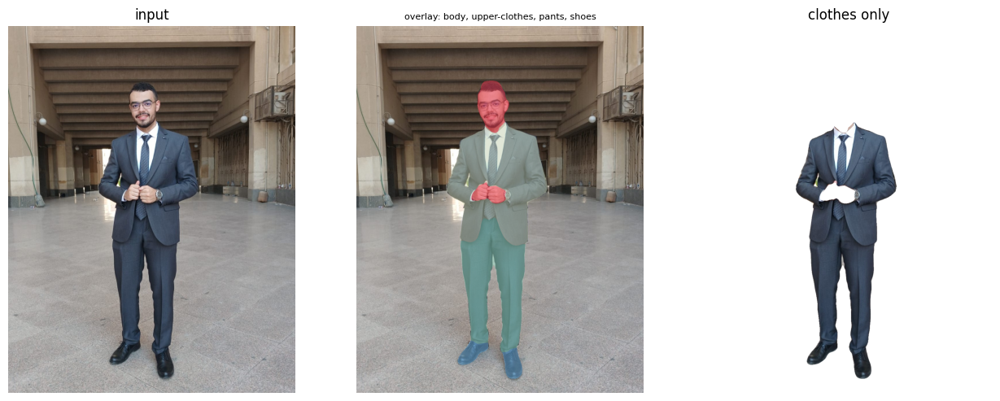

# Clothes Segmentation (CVCY002)

Deep-learning model that segments worn clothes from images of people (e.g. for virtual fitting rooms).
A U-Net with a pretrained ResNet34 encoder is trained on the ATR human-parsing dataset (11 clothes-focused classes).

| | mIoU | mDice | Pixel acc. |
|---|---|---|---|
| **Validation** (1,000 images) | **0.7685** | 0.8631 | 0.9816 |
| Test (200 images) | 0.6135 (0.6748 over classes present) | 0.7068 | 0.9745 |

Target performance (self-defined, the assignment does not give a number): validation mIoU >= 0.70, met.
Inference speed: 9.2 ms per 512x512 image on a Tesla T4 (about 109 FPS), 24.4M parameters.

The full write-up (dataset choice, architecture, loss, metrics, failure analysis, limitations) is in [`report.md`](report.md).



## Project structure

```
clothes-segmentation/
├── README.md
├── report.md                  # dataset, architecture, loss, metrics, limitations
├── requirements.txt
├── notebooks/
│   └── segmentation-clothes-kaggle.ipynb   # the executed Kaggle run that produced the reported numbers
├── src/
│   ├── convert_parquet.py     # parquet -> images/ + masks/ folders
│   ├── dataset.py             # class remapping, preprocessing, augmentation, loaders
│   ├── model.py               # U-Net builder, checkpoint loading, flip-TTA helper
│   ├── losses.py              # class-weighted cross-entropy + Dice
│   ├── metrics.py             # confusion-matrix metrics (mIoU, Dice, per-class)
│   ├── train.py               # training (AMP, EMA, cosine LR, resumable)
│   ├── evaluate.py            # val/test metrics, confusion matrix, best/worst cases
│   ├── infer.py               # personal photo -> mask / overlay / clothes cutout
│   ├── viz.py                 # plotting helpers
│   ├── plot_curves.py         # history.csv -> curves.png
│   └── export_weights.py      # best.pt -> fp16 inference-only file (about half the size)
├── data/                      # dataset goes here (git-ignored)
├── results/
│   └── figures/               # curves, confusion matrix, best/worst cases, samples
└── samples/{input,output}/    # your own photos and their segmentation
```

## 1. Setup

```bash
python -m venv venv
venv\Scripts\activate            # Windows   (Linux/macOS: source venv/bin/activate)
# install PyTorch for your CUDA version first: https://pytorch.org/get-started/locally/
pip install -r requirements.txt
```

## 2. Data

Download the ATR dataset (parquet version from Hugging Face) into `data/ATRDataset/data/` so it contains
`train-*.parquet`, `validation-*.parquet` and `test-*.parquet`, then convert it:

```bash
python src/convert_parquet.py --data-dir data/ATRDataset/data --out-dir data/ATR_extracted
```

Splits: 16,706 train / 1,000 val / 200 test. Check the data pipeline (prints raw label ids, class balance, one batch shape):

```bash
python src/dataset.py
```

**Classes.** The 18 ATR labels are merged into 11 (hair, face, arms, legs, sunglasses -> `body`; left/right shoes -> `shoes`):
`background, body, hat, upper-clothes, skirt, pants, dress, belt, shoes, bag, scarf`. Use `--full18` to keep all 18.

## 3. Train

The reported model was trained on Kaggle (2x T4, effective batch 32). The equivalent single-GPU command, if you have about 16 GB of VRAM:

```bash
python src/train.py --size 512 --bs 16 --accum 2 --epochs 25
```

For a small GPU (e.g. 4 GB) trade resolution and batch size for gradient accumulation:

```bash
python src/train.py --size 384 --bs 4 --accum 8 --epochs 25
```

Outputs go to `results/exp1/`: `best.pt` (best validation mIoU; EMA or raw weights, whichever validated better),
`last.pt` (for resuming), `history.csv`, `class_freq.npy`. Training is resumable: re-run the same command.
Training uses ImageNet-pretrained weights, so the first run needs internet access.

```bash
python src/plot_curves.py --exp results/exp1     # -> results/exp1/curves.png
```

## 4. Evaluate

```bash
python src/evaluate.py --out results/exp1          # add --tta for flip test-time augmentation
```

Prints val/test mIoU, mDice, pixel accuracy and per-class IoU; writes `per_class_val_test.csv`, `test_metrics.json`,
`confusion_matrix.png`, `worst_cases.png` and `best_cases.png` into `results/exp1/`.

## 5. Run on your own photo

```bash
python src/infer.py --ckpt results/exp1/best.pt --input samples/input --output samples/output
```

`--input` can be one image or a folder. For each photo you get a color mask, an overlay, a transparent
clothes-only cutout and a side-by-side panel.

## Model weights

`best.pt` is about 98 MB. To share it, shrink it first and attach it to a GitHub Release (or Git LFS):

```bash
python src/export_weights.py --ckpt results/exp1/best.pt --out results/exp1/model_fp16.pt
```

`infer.py` and `evaluate.py` load the fp16 file directly (`--ckpt results/exp1/model_fp16.pt`).

## Reproducing the results

- **Exact numbers:** open `notebooks/segmentation-clothes-kaggle.ipynb` on Kaggle (GPU T4 x2, internet on, ATR dataset attached) and run all cells. It trains with DistributedDataParallel and writes the metrics and figures stored in `results/figures/`.
- **With the scripts:** the pipeline above uses the same data processing, model, loss, optimizer and EMA. Expect small run-to-run differences because of different GPU count, seeds and non-deterministic kernels.

## Known limitations (short version)

- Single-color top + trousers photographed waist-up are often labeled as one "dress" (the main failure mode).
- Rare and thin classes (belt, scarf, hat, bag) are the least reliable; the 200-image test split contains almost none of them.
- One person per image, 11 classes, no instance separation. Details and figures in [`report.md`](report.md).
